# ⚡ GIGAWATT — AI Datacenter Tycoon

**[ixaxaar.github.io/gigawatt](https://ixaxaar.github.io/gigawatt/)**

**Build an AI datacenter from 2020 to 2028.** Buy real GPUs, NICs and switches, design your own server trays and racks, power and cool a hall, wire a fat-tree fabric into a supercomputer, and lease it to customers who want to **train** and **serve** frontier models — all while the price of electricity, the hardware roadmap and the odd backhoe conspire against you.

The front-end is a **Godot 4** game (Vulkan, forward+, a 1 unit = 1 m scale-model datacenter). Every rule — physics of power and cooling, fabric bisection, MFU, inference capacity, contracts, markets, incidents — runs in a deterministic TypeScript engine that Godot drives through a headless Node sidecar.

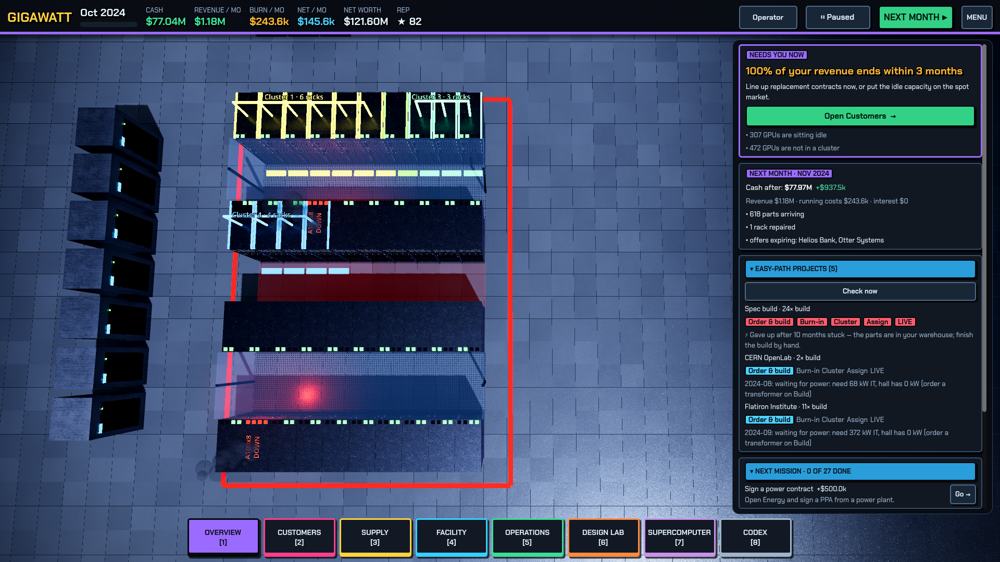

## What you actually do

| | |
|---|---|
| **Procure** | A guided build planner (platform → how many → who builds it → order) plus a full parts bin: **690+ real parts from 100+ vendors** (power, cooling, network, storage, memory, racks, accelerators) with specs, lead times and volume discounts, plus 71 ready-to-order system templates from 12 integrators. |
| **Design Lab** | A motherboard-level tray bench (CPU sockets, DIMM banks, GPU/NVSwitch, NICs, NVMe, PSUs) and a 42U rack elevation, with live validation and a 5-year cost / sizing advisor. |
| **Build** | Power & cooling gauges, transformers/UPS/CRAH/CDU/chillers, outage-protection tiers, internet circuits, and new halls. |
| **Warehouse** | Rack assembly, "order all missing", deploy, spares, in-transit orders and the ledger. |
| **Supercomputer** | Group racks into one machine; auto-design or hand-tune the fabric; see what it can train or serve (per-model tok/s, MFU, TTFT). Uncluster and re-cluster any time. |
| **Customers** | Market offers with live fit verdicts and "what you need to buy"; an **Easy Path** that orders, installs, deploys and assigns for you; serve straight from racks. |
| **Energy** | Power purchase agreements, the spot GPU market, offering idle capacity. |
| **Operations** | Staffing (the crew you need scales with racks, liquid cooling and fabric size; understaffing raises failures and slows repairs), loans and repayment, a **hardware lifecycle** table (age, obsolescence, residual value, sell old racks), and clearing warehouse stock. |
| **Roadmap** | Hardware keynotes (GTC, Computex, SC, OCP, AMD Advancing AI) fire on their real dates: a card explains the technology and what it changes in your hall. Announced parts can be **pre-ordered** at a launch premium and arrive after they ship; cancelling refunds 90%. |
| **Codex** | "Datacenter 101": every concept with a live *do I need this right now?* verdict, plus the accelerator timeline. |

The campaign runs Dec 2020 → Dec 2028 and ends with a scored report (net worth, reliability, scale); three months of negative cash is bankruptcy (Learner mode can't go bankrupt). Saves are versioned with three slots plus a monthly autosave.

Three modes — **Learner** (tips everywhere), **Operator**, **Tycoon**. A short guided tutorial walks a first run from the first customer to the first revenue, then hands over to a seven-chapter **Learning path** (power and cooling, silicon, networks, customers, money, resilience) with cash-rewarded goals and live "do I need this now?" concepts.

## Screenshots

| Thermal view | Supercomputer builder |
|---|---|
| 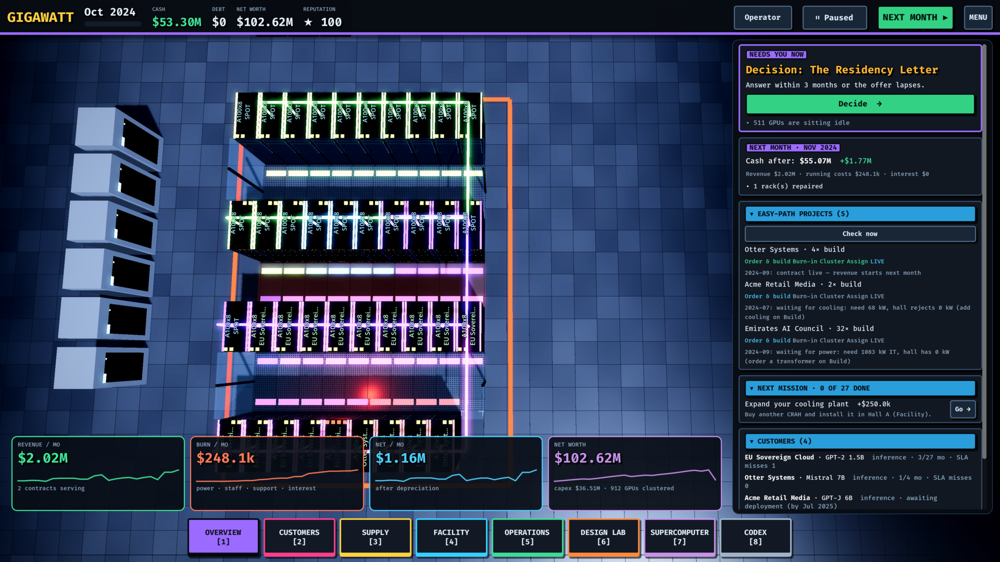 | 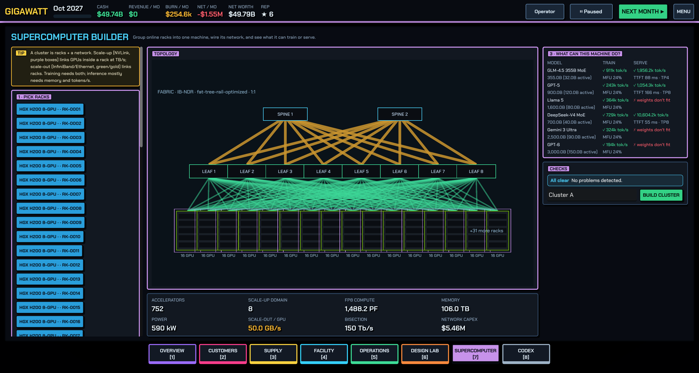 |
| **Procurement planner** | **Design Lab** |
| 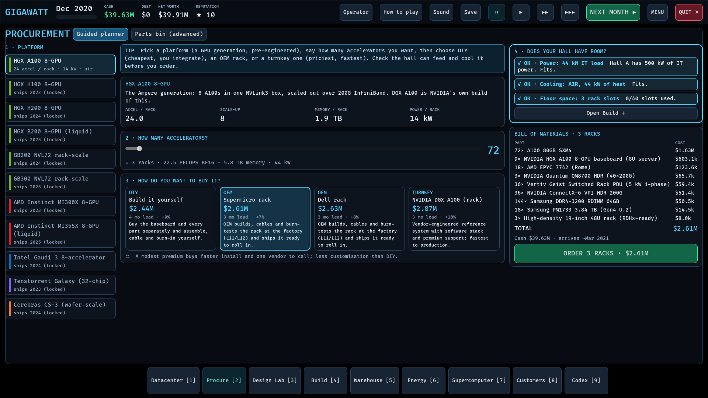 | 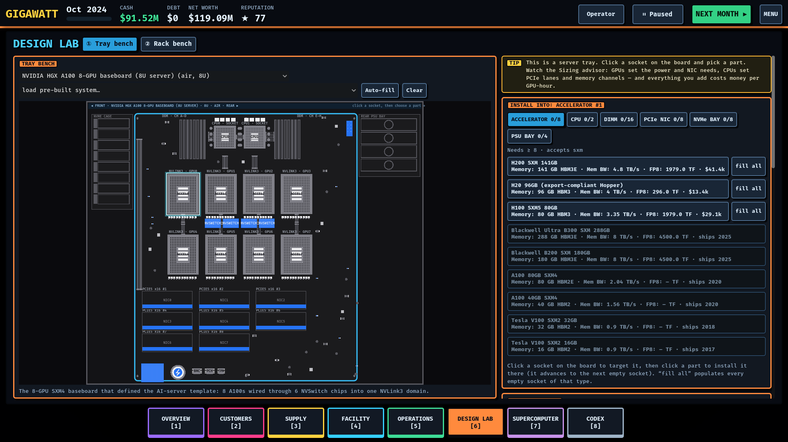 |
| **Customers & contracts** | **Codex** |
| 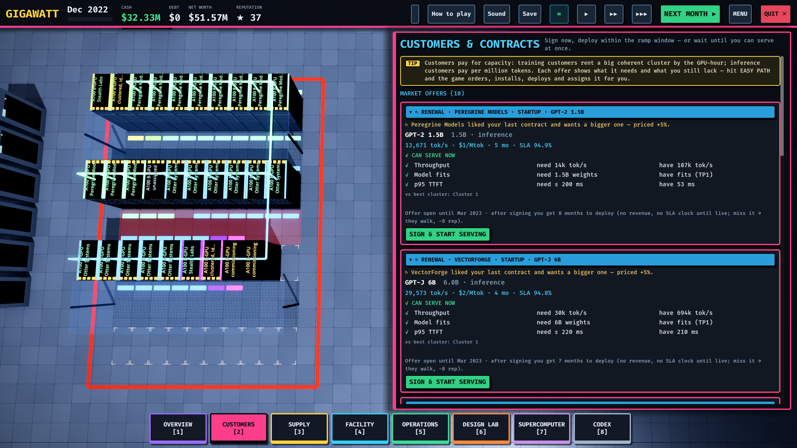 | 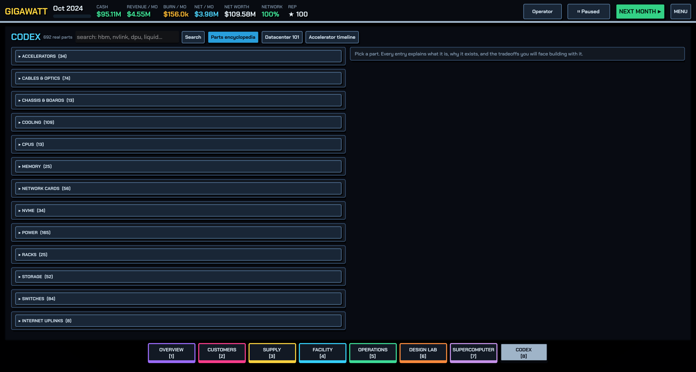 |

## At campus scale

The same engine runs multi-hall campuses (the `stress-campus` scenario: eight halls, every rack type, hundreds of racks, a few hundred MW).

| Liquid-cooled hall (DLC) | Thermal view of the same hall |
|---|---|
| 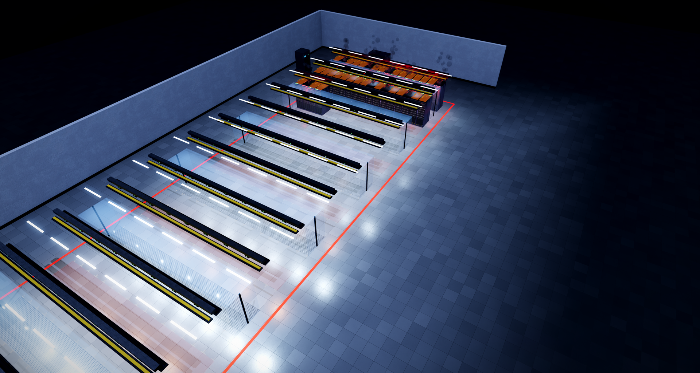 | 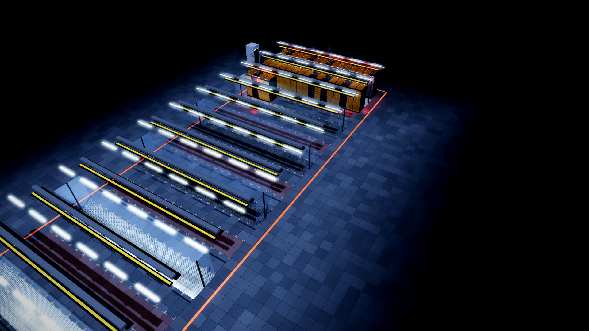 |
| **Rear-door heat exchanger hall** | **Down the cold aisle** |
| 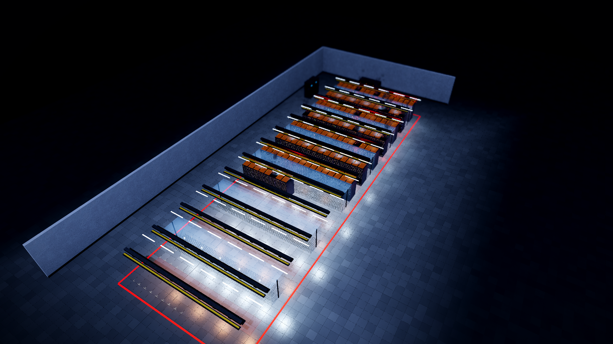 | 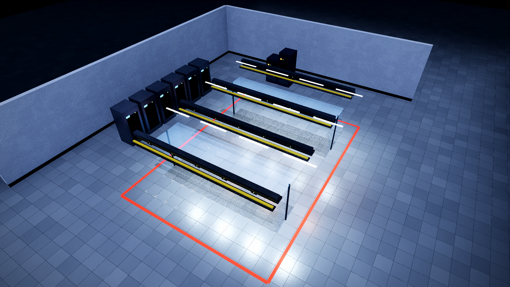 |

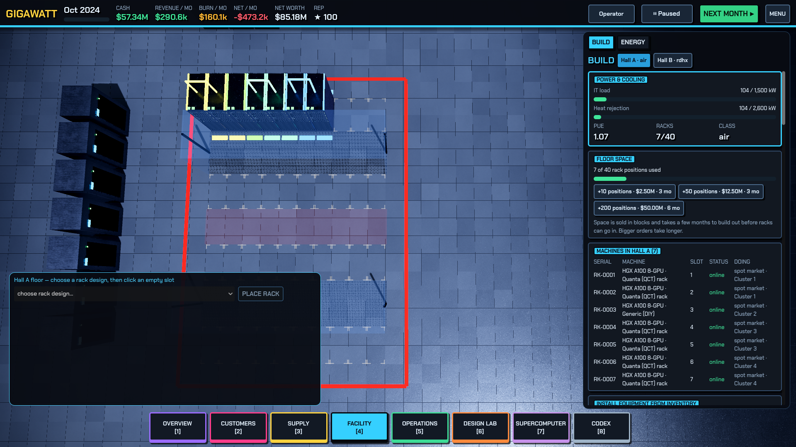

The Build screen shows floor space (bought in blocks, with a commissioning delay) and a machine ledger: every rack's serial, slot, status and what it is doing right now.

## Download

Grab the archive for your OS from [Releases](https://github.com/ixaxaar/gigawatt/releases), extract, and run. Node.js is bundled; nothing else to install.

| OS | File | Run |
|---|---|---|
| Windows (x64) | `GIGAWATT-<ver>-windows.zip` | `GIGAWATT\GIGAWATT.exe` (SmartScreen: *More info → Run anyway*) |
| Linux (x86_64) | `GIGAWATT-<ver>-linux.tar.gz` | `GIGAWATT/gigawatt.sh` (needs a Vulkan GPU/driver) |
| macOS, Apple Silicon | `GIGAWATT-<ver>-macos-arm64.zip` | `xattr -dr com.apple.quarantine GIGAWATT.app`, then open |
| macOS, Intel | `GIGAWATT-<ver>-macos-x64.zip` | same as above |

Builds are unsigned, hence the OS warnings. Releases are built by `.github/workflows/release.yml` on every `v*` tag (`scripts/package.sh` assembles the Godot export, the sidecar and a Node runtime).

## Run from source

Requirements: **Godot 4.x** (developed on 4.7), **Node 18+**, a Vulkan GPU recommended.

```sh
cd godot
./run.sh            # launches with Vulkan Forward+ (see note below)
```

`run.sh` points Vulkan at the NVIDIA ICD and forces `forward_plus`; on hybrid AMD+NVIDIA laptops the default loader otherwise falls back to OpenGL compatibility. Edit it for your GPU, or just run `godot --path godot`.

**Controls:** `1`–`8` open a drawer (Overview, Customers, Supply, Facility, Operations) or workshop (Design Lab, Supercomputer, Codex); press the same key again to close it · `Space` next month · the hall opens in top view with every rack labelled by hardware and customer: left-drag or `WASD` pan, right-drag orbit, wheel zoom, `Q/E` rotate, `V` top view, `L` labels, `T` thermal view · click a rack to inspect it · `Esc` menu · `Ctrl+Q` quit. Graphics Low/Balanced/High under Settings.

See [ARCHITECTURE.md](ARCHITECTURE.md) for how the engine is organised and where to add actions, queries and monthly systems.

## Playtesting

`PLAYTEST=1 ./node_modules/.bin/vitest run src/playtest` plays full 97-month campaigns with six scripted players (idle, random, operator, tycoon, cautious, spot-only), checks whole-state invariants every month, verifies determinism and save/load round-trips, and writes `docs/playtest/report.md`. `GW_SMOKE=1 GW_SMOKE_YEARS=8 godot --headless --path godot` soak-tests the UI: a scripted player runs year by year and every screen must still build.

## Train agents on it

The simulation core is deterministic and headless, so it doubles as an environment for agents (RL, LLM tool-use, scripted bots).
It has a Gymnasium-shaped API (`reset` / `step` / `legalActions` / state `hash`), a scenario library (including multi-hall stress
campuses with every rack type deployed), and a Python client.

```python
from gigawatt_env import GigawattEnv            # python/gigawatt_env.py
env = GigawattEnv()
obs, _ = env.reset(seed=1, scenario="lean")
obs, reward, done, truncated, info = env.step({"name": "nextMonth"})
```

Reward is net-worth change per month; the reference agents separate cleanly (idle −$1.0M, random +$0.6M, scripted operator +$15.5M
over 30 months). Details, action list and limits: [`docs/AGENT_ENV.md`](docs/AGENT_ENV.md).

## Architecture

```
godot/                 Godot 4 front-end (GDScript)
  engine/bridge.gd     spawns the Node sidecar, JSON-lines over stdin/stdout
  sidecar/bridge.mjs   built TS engine (committed)
  world/hall_view.gd   realistic 3D hall: shader-drawn racks, raised floor, containment, cluster markers
  ui/                  every screen, Kit (widgets), tray/rack boards, topology view
src/                   the TypeScript engine (types, data catalog, sim, store)
src/bridge.ts          actions, read-only queries and the agent API exposed to Godot / Python
src/env/               agent environment: env, scenarios, reference agents, determinism + stress tests
python/                Gymnasium-style client
```

Rebuild the sidecar after changing the engine:

```sh
pnpm install
./node_modules/.bin/vite build -c vite.bridge.config.ts   # -> godot/sidecar/bridge.mjs
./node_modules/.bin/vitest run                            # engine tests
```


## Data quality

The catalogue spans NVIDIA/AMD/Intel accelerators, 20+ switch and NIC vendors, the major power and cooling OEMs (Eaton, Schneider, Vertiv, Cat, Cummins, MTU, Trane, Carrier, Daikin, ...), storage (DDN, VAST, WEKA, Pure, NetApp, ...) and server integrators (Dell, Supermicro, HPE, Lenovo, Quanta, Wiwynn, ASUS, Cisco, ...). It is broad, not guaranteed SKU-complete: about 96 entries are tagged `unverified` (recalled from memory, not checked against a datasheet), and prices are typical street figures. Accelerator and CPU specs drive the performance model and are hand-checked; the rest are audited for units, ranges and physical plausibility. Corrections welcome.

## Status

Early but playable. Known gaps: advisor bubble, per-mode tip toggling, part art, drag-and-drop in the Design Lab, objectives/incident cards in the Godot layer.
