# GIGAWATT interaction graph

Every player action, the lifecycle of every entity it touches, what it must and must not do, how it reports back, and which UI control triggers it. The machine-readable source of truth is [`src/engine/interactions.ts`](../src/engine/interactions.ts); this page is the human version of the same graph. [`src/engine/interactions.test.ts`](../src/engine/interactions.test.ts) checks the engine against it (`pnpm run test:interactions`).

## Rules of consistency

These are what the player can rely on. Each rule is checked automatically; known violations are listed at the end with a suggested fix and pinned by an `it.fails` test, so a fix shows up as a test to flip.

| rule | meaning |
|---|---|
| **R1 Only Sign signs** | `acceptContract` is the only action that moves an offer into your contracts. Easy Path (`startEasy`) and Serve-from-racks (`assignRacks`) sign by calling it, and say so. Ordering (`buy`, `buyTemplate`), placing, clustering and the Easy-path steps never sign. |
| **R2 Every result is explained** | Every result action returns `{ok, message, issues?}`. A failure has a non-empty, human message; `issues` lists the individual problems (`severity`, `code`, `message`). |
| **R3 Failure changes nothing** | A failed action leaves the game exactly as it was (deep-equal). No half-signed contracts, no orphan designs, no stray clusters. |
| **R4 Preconditions decide** | If a precondition in the tables below is false, the action fails. For actions marked exact, if they all hold it succeeds. |
| **R5 Only drawn transitions happen** | Every entity state change an action causes is an edge of that entity's diagram labelled with the action (or one it calls). |
| **R6 Declared side effects only** | An action only touches what its row says (plus what the actions it calls touch). |
| **R7 An enabled button succeeds** | When the UI enables a button it succeeds. When the gate is a query (verdict, quote, readiness), the query and the action agree. |
| **R8 Invariants** | After every action: a contract is offered or signed, never both; contracts, racks and spot lists only reference clusters / racks that exist; no rack is in two clusters and every rack's `clusterId` matches its cluster; a training contract owns its clusters exclusively; money and stock are finite and non-negative; orders have positive whole quantities. |
| **R9 Everything is modelled** | Every store action and every `b.act("…")` call under `godot/` is in the graph, with the UI binding listed here. |

## How it is verified

`src/engine/interactions.test.ts` runs in about 6 seconds and is part of `pnpm test`:

1. **Coverage (R9).** The modelled actions equal the bridge's action list; every `b.act("name")` in `godot/**/*.gd` names a modelled action and is listed as a UI binding; every binding's file really calls it; every `b.q("name")` is an existing query; the diagrams are well-formed.
2. **Conformance on crafted states.** About 45 invalid calls (one per precondition family) must fail with a message and change nothing. A manual path (order → sign → deliver → place → commission → cluster → serve → release → re-serve → disband) and an Easy-path project are driven end to end, with every step checked against the graph.
3. **Model-based random walk.** 5 seeds × learner/operator/tycoon × 60 months, 8 random actions a month drawn from the current state (valid and invalid arguments), then `nextMonth`. After every action: result shape (R2); failure ⇒ unchanged (R3); preconditions vs outcome (R4); observed lifecycle changes are graph edges (R5); observed side effects are declared (R6); global invariants (R8). The run fails if it does not reach the interesting parts of the graph (signing, serving, completion, walk-aways, commissioning, clustering, an Easy-path project finishing).
4. **UI / engine agreement (R7).** Every third month of the walk, in a sandbox: the Customers verdict (`contractFit`) vs. sign + assign to the best cluster; the build list (`buildOptions`) vs. EASY PATH and "Just order the racks"; the Shop quote vs. ORDER; `frameworkQuote.valid` vs. `signFramework`; `rackReadiness` vs. `placeRack`; the floor-space, plant, repay, BUILD CLUSTER and Sell gates vs. their actions.

## Adding an action or a UI control (process)

1. Add or change the store action in `src/engine/actions/*`.
2. Add its `ActionSpec` to `ACTIONS_SPEC` in `src/engine/interactions.ts`: arguments, preconditions (`guards`, as predicates over `GameState` that use the same data the engine checks), allowed `effects`, `calls`, a `post` condition when useful, and the `ui` bindings (file, control, and the gate that disables it). If it moves an entity, add the edge to that entity's machine in `MACHINES`.
3. Add a new button that calls `b.act(...)` to the action's `ui` list. If the button is gated by a query, add the agreement check to `agreement()` in the test.
4. Update this page (diagrams and tables) and run `pnpm run test:interactions`.

The test fails if a store action or a `b.act` call site is missing from the graph, so step 2 cannot be forgotten. CI runs it in the `test` job of `.github/workflows/release.yml`.

## Effects vocabulary

`sign` offer → signed · `assign` an active contract's clusters / deadline changed · `close` an active contract left · `offers` the offer board changed · `cash-` / `cash+` / `debt` · `order+` / `order-` · `inventory` / `spares` / `design` / `reserve` · `hall` shell, plant or floor · `rack+` / `rack-` / `rack~` placed racks · `membership` a rack joined/left a cluster · `cluster+` / `cluster-` / `cluster~` · `project` · `staff` · `uplink` · `power` · `spot` · `vendor` · `policy` · `mode` · `site` · `news` · `story` · `reputation` · `utility` · `month` · `status`. The log, id counters and lifetime stats are not effects.

## Entity lifecycles

`[*]` is "does not exist". "month tick" is `nextMonth` (the monthly simulation); `nextMonth` also steps every Easy-path project once, so any Easy-path edge can happen on a month advance.

### contract

A customer contract: offered on the board, signed (pending deployment), serving, then gone (completed, walked away or expired). Renewals arrive as NEW offers with id `<old>-r<month>`.

| state | meaning |
|---|---|
| `absent` | not on the board / no longer active |
| `offered` | on the market board (availableContracts) |
| `pending` | signed, no cluster yet; deployBy clock running |
| `serving` | signed with ≥1 cluster assigned; revenue + SLA clock |

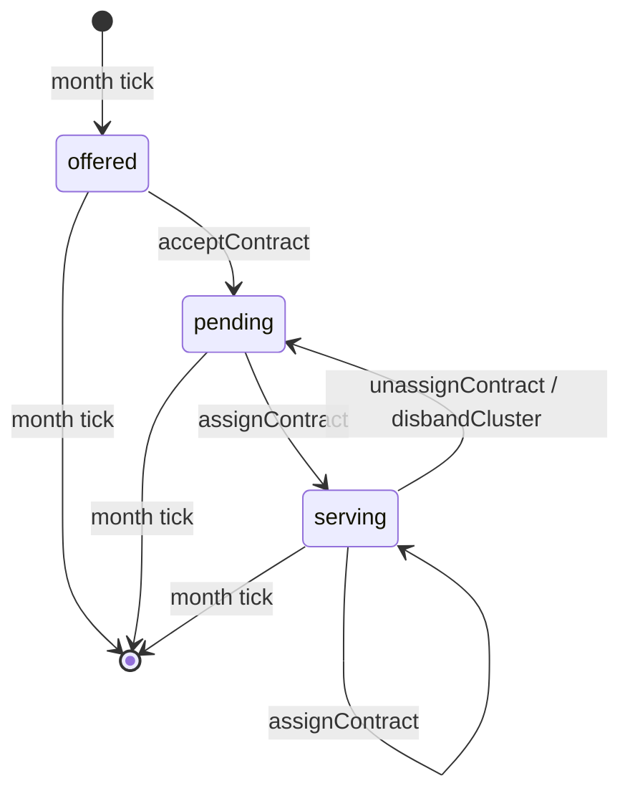

- `absent → offered` (month tick): fresh offers each month; renewals 4 months before the end of a clean contract or at completion
- `offered → absent` (month tick): deadlineMonth passed, or trimmed by the 10-offer board cap
- `offered → pending` (acceptContract): Sign. The ONLY way to sign apart from Easy Path / Serve-from-racks, which call it.
- `pending → serving` (assignContract): a qualifying cluster set
- `serving → serving` (assignContract): change the cluster set
- `serving → pending` (unassignContract, disbandCluster): deployBy = max(deployBy, month+2)
- `pending → absent` (month tick): walked: month > deployBy (one 3-month extension if an Easy-path build is under way); −8 reputation
- `serving → absent` (month tick): completed: monthsServed ≥ durationMonths; reputation gain; renewal offer if clean

### rack

A physical rack on a hall floor. (Racks on order are parts in `orders`, not placed racks: status `ordered` exists in the type but nothing produces it.)

| state | meaning |
|---|---|
| `absent` | not on the floor |
| `installing` | placed, being installed |
| `commissioning` | burn-in |
| `online` | serving-capable |
| `failed` | down (burn-in DOA or a part failure), back at readyMonth |

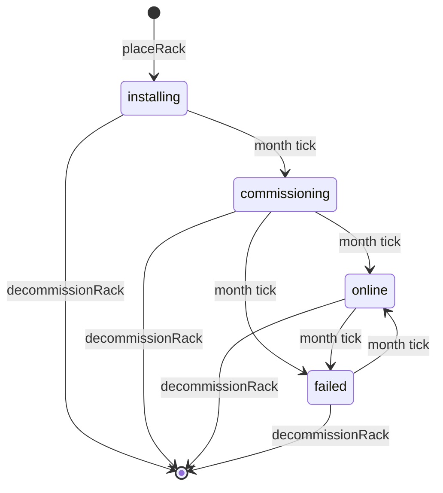

- `absent → installing` (placeRack): consumes one rack BOM from free inventory and one reservation
- `commissioning → failed` (month tick): dead on arrival (burn-in policy changes the odds)
- `online → failed` (month tick): part failure; a spare on the shelf makes it a one-month repair
- `online → absent` (decommissionRack): only when not in a cluster

### rackMembership

Whether a placed rack belongs to a cluster.

| state | meaning |
|---|---|
| `absent` | not placed |
| `free` | placed, in no cluster (may be on spot by itself) |
| `clustered` | part of exactly one cluster |

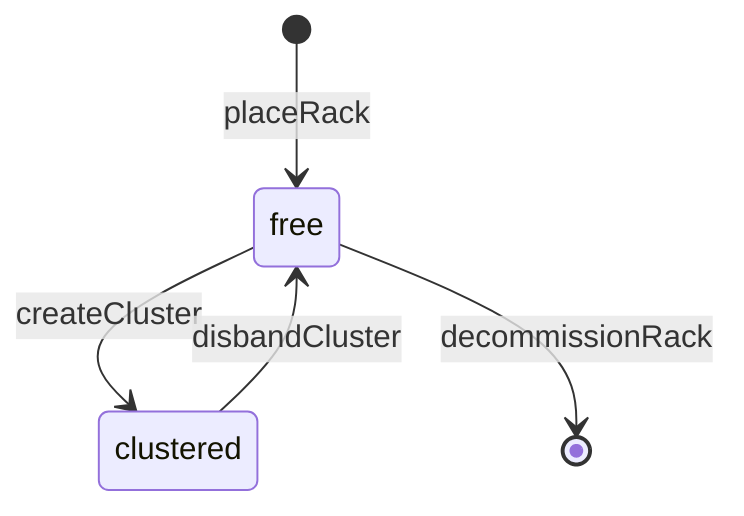

### cluster

A set of racks joined by a scale-out fabric. Ids are never reused.

| state | meaning |
|---|---|
| `absent` | does not exist |
| `idle` | exists, serves no contract |
| `serving` | assigned to ≥1 active contract |

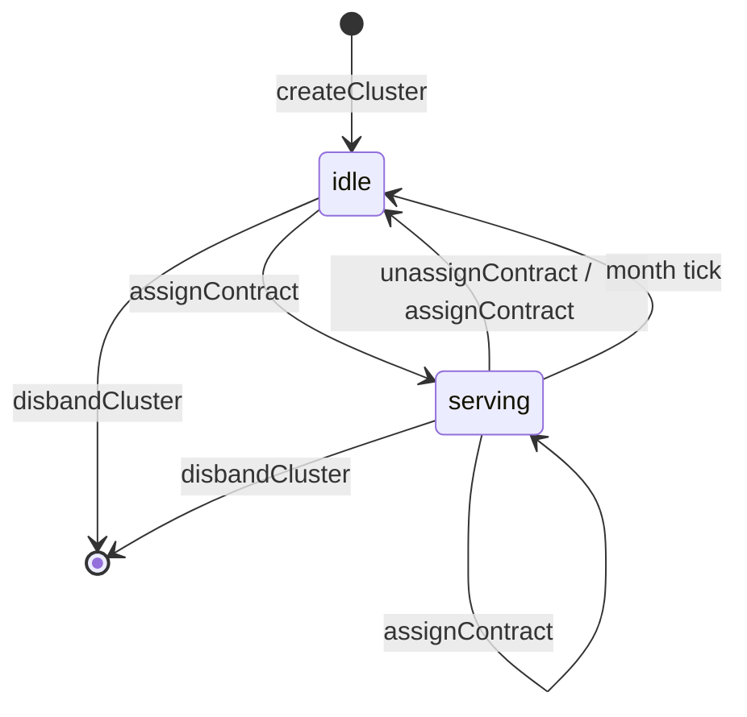

- `serving → idle` (unassignContract, assignContract): released, or dropped from a contract’s new cluster set
- `serving → idle` (month tick): its last contract completed or walked
- `serving → absent` (disbandCluster): its contracts drop back to pending (2-month grace)

### order

An open purchase line. buyTemplate creates a batch (one line per part, shared `batch` id) that is cancelled / reduced as a unit.

| state | meaning |
|---|---|
| `absent` | not open |
| `open` | in transit, arrives at arriveMonth |

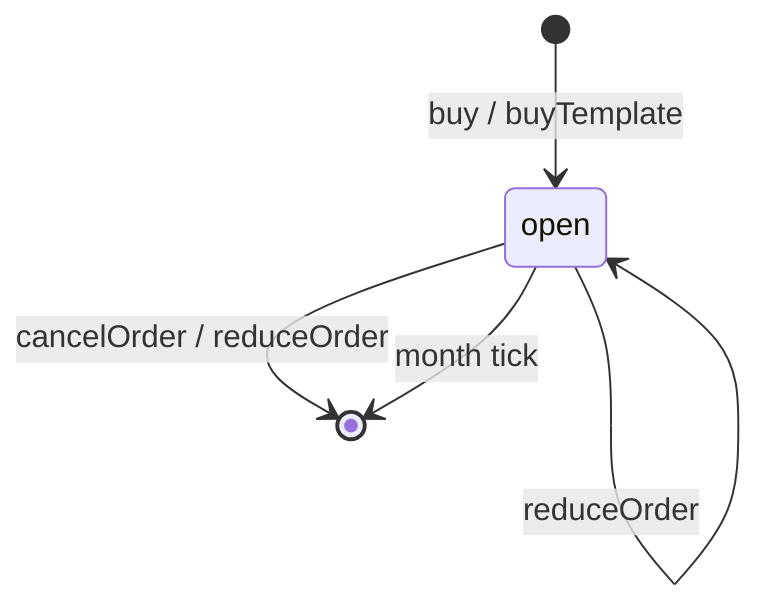

- `open → open` (reduceOrder): qty reduced, 90% of the difference refunded
- `open → absent` (cancelOrder, reduceOrder): cancelled (90% refund) or reduced to zero
- `open → absent` (month tick): arrived: parts land in inventory (spare lines on the spares shelf)

### project

An Easy-path build for one contract. It signs (via acceptContract) when started, then installs plant, places racks, clusters and assigns as parts arrive. It never signs anything later.

| state | meaning |
|---|---|
| `absent` | none |
| `building` | waiting for parts / plant, placing racks |
| `commissioning` | all racks placed, waiting until all are online |
| `clustering` | building the fabric |
| `assigning` | assigning the new cluster to its contract |
| `done` | contract served |
| `failed` | gave up (order cancelled, contract gone, stuck >10 months) |

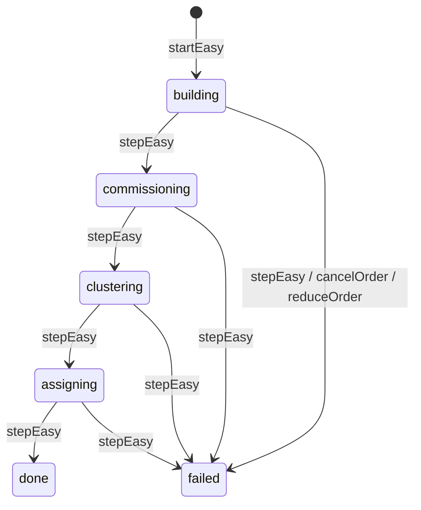

- `building → failed` (stepEasy, cancelOrder, reduceOrder): order cancelled, or stuck more than 10 months
- `commissioning → failed` (stepEasy): contract no longer active

### hall

A data hall: cooling class, rack slots, IT power and heat rejection. Halls are never removed.

| state | meaning |
|---|---|
| `absent` | not built |
| `built` | shell exists (power/cooling/floor change via install*/expandHall) |

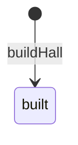

### framework

A vendor framework agreement (commit spend for a discount).

| state | meaning |
|---|---|
| `absent` | none |
| `active` | running until endMonth |

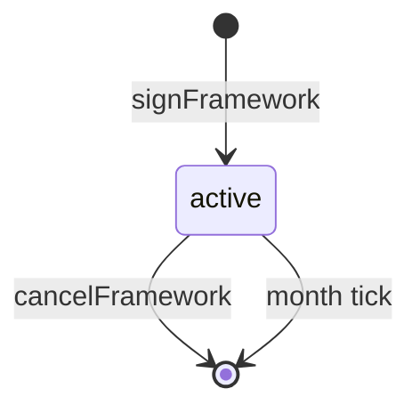

- `active → absent` (cancelFramework): 20% of the unmet commitment as a penalty
- `active → absent` (month tick): expired at endMonth

### powerDeal

Power purchase agreements: an offer on the energy board becomes a contract (same id) when signed.

| state | meaning |
|---|---|
| `absent` | none |
| `offered` | on the energy board |
| `signed` | take-or-pay PPA running |

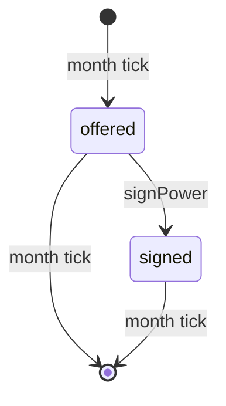

- `signed → absent` (month tick): term ended

### dilemma

A story decision card.

| state | meaning |
|---|---|
| `absent` | none open |
| `open` | waiting for an answer (lapses after 3 months) |

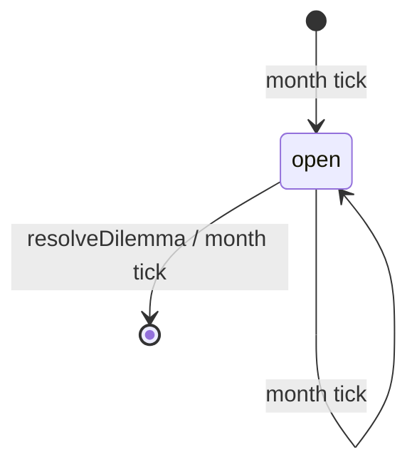

- `open → open` (month tick): replaced by a new one

### session

The game itself.

| state | meaning |
|---|---|
| `playing` | normal play |
| `bankrupt` | cash < 0 for 3 months (not in learner mode) |
| `fired` | three missed board reviews |
| `finished` | reached Dec 2028 |

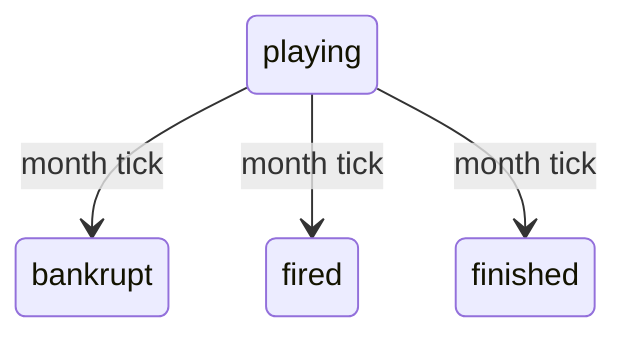

## Actions

Preconditions are listed in the order the engine checks them. "plus engine-only checks" marks actions whose full rule set lives in the engine (cluster capacity maths, fabric evaluation, pricing); the graph only lists the necessary conditions. ⚠ marks a rule the engine does not enforce today.

### Easy Path in detail (`startEasy`)

What the EASY PATH button does, in order:

1. If you already own an idle cluster that qualifies (`contractFit` ok, not serving anyone): **sign** (if still an offer) and **assign** it now. Nothing is ordered. The confirm dialog says it "orders what is needed (up to N racks)", which covers this case.
2. Otherwise the chosen build must be in `buildOptions` for this contract, with at least its rack count, and arrive within the ramp window (`fitsRamp`), else it fails without signing. For an already-signed contract the engine still measures the window from today + rampMonths, not from `deployBy` as the UI does (`KI-easy-pending-deadline`).
3. **Sign** (`acceptContract`, if still an offer), then **order** the template (`buyTemplate`, with spares). If anything fails (cash, allocation, or an idle-cluster assign that the build path then refuses) the whole call is undone: the customer is not signed and nothing is ordered.
4. Pick a hall with the right cooling class and room, else **build** one (`buildHall`). **Order** transformers and cooling to cover the hall's load (`buy`; failures are only noted in the project).
5. Create the project (`building`) and step it once.

Each later step (`stepEasy`, also run by `nextMonth`) never signs: it installs plant as it arrives, tops up missing plant, places racks when parts, power, cooling and floor allow (`commissioning`), waits until all are online, builds the cheapest qualifying fabric (`clustering`), then assigns the contract (`assigning` → `done`). It fails when its order is cancelled, when the contract is gone after building, or after 10 months stuck. It also keeps internet transit ahead of demand (`buyUplink`).

### Who signs, who orders

| action | signs? | orders? | assigns? |
|---|---|---|---|
| `acceptContract` (SIGN NOW · DEPLOY LATER) | yes | no | no |
| SIGN & START SERVING (UI: `acceptContract` then `assignContract(best)`) | yes | no | yes, if it qualifies. Two separate actions: if the assign fails, the contract stays signed. |
| `buyTemplate` (Shop ORDER, "Just order the racks") | **never** | yes | no |
| `buy` | never | yes | no |
| `startEasy` (EASY PATH) | yes, at once | yes, unless an idle cluster is reused | at once (reuse) or later (project) |
| `assignRacks` (SERVE FROM N RACKS) | yes, if still an offer | no | yes (auto-cluster) |
| `stepEasy` / `nextMonth` | never | plant and transit only | yes, for its own project |

### session

| action | preconditions (all must hold) | effects on success | feedback | UI control (disabled when) |
|---|---|---|---|---|
| **newGame**(seed?, mode?) Fresh game. Learner starts with $80M, tycoon $30M, operator $50M. At least one opening offer is servable in time. | — | anything | void | Title ▸ New game (mode picker) — `main.gd` |
| **setMode**(mode) Switch learner/operator/tycoon mid-game. Cash and hall are untouched. | mode is learner, operator or tycoon | mode | void | Top bar mode button (confirm dialog) — `main.gd` |
| **nextMonth**() Run the monthly tick (deliveries, commissioning, failures, contracts, market, finance, story, board, endgame) then step every Easy-path project once. No-op when the game is over. | game status is playing | anything | void | NEXT MONTH button / Space — `main.gd` |
| **save**(slot?) Write the game to a save slot (localStorage). Never changes the game. | — | none | {ok, message, issues?} | Pause menu ▸ Save game ▸ slot; autosave on quit — `main.gd` |
| **load**(slot?) Replace the game with a saved one (migrated to the current schema). | — | anything | {ok, message, issues?} | Title / pause menu ▸ Load game ▸ slot — `main.gd` |
| **ackNews**() Dismiss the oldest keynote card. | — | news | void | Keynote card ▸ close — `ui/keynote.gd` Keynote overlay dismiss — `main.gd` |
| **ackStory**() Dismiss the oldest chapter card. | — | story | void | Chapter card ▸ continue — `ui/story.gd` Chapter overlay dismiss — `main.gd` |
| **setSite**(site) Cosmetic hall look. | — | site | void | Change look — `main.gd` |
| **resolveDilemma**(choice) Answer the open decision card. | a decision is open; choice is 0 or 1; a paid option is affordable | cash+, cash-, reputation, staff, utility, story | {ok, message, issues?} | Decision card ▸ choice A / B — `ui/story.gd` |

### procure

| action | preconditions (all must hold) | effects on success | feedback | UI control (disabled when) |
|---|---|---|---|---|
| **buy**(itemId, qty, spare?) Order loose parts (capped by vendor allocation). Never signs, never places. | item exists; not an internet circuit (those use buyUplink); qty is a positive number; qty rounds down to at least 1; the part is purchasable this month (shipping or pre-order open); cash covers the (capped, discounted) cost | cash-, order+, vendor | {ok, message, issues?} | Parts bin ▸ Buy (and spares) — `ui/screens/procure.gd` (total > cash) Build ▸ plant ▸ Buy 1 — `ui/screens/facility.gd` (offer.unitPrice > cash) Missing parts ▸ ORDER — `ui/screens/missing_parts.gd` Spares ▸ Buy N — `ui/screens/stock.gd` |
| **buyTemplate**(templateId, racks, spares=true) Adopt a template’s tray+rack designs and order its full bill of materials (+ bundled spares) as one batch; reserves the racks for that design. Atomic: a refused order adopts no designs. MUST NOT sign any contract. | template exists; at least one rack; plus engine-only checks | cash-, order+, reserve, vendor + whatever adoptTemplate do | {ok, message, issues?} | Shop ▸ ORDER N RACKS — `ui/screens/procure.gd` (quote.cost > cash, or quote.unavailable, or not quote.orderable (shows quote.blocker)) Offer / Pending ▸ What you need ▸ Just order the racks (confirm) — `ui/screens/contracts.gd` (buildOption.orderCost > cash or not buildOption.canOrder (shows orderBlocker)) |
| **cancelOrder**(orderId) Cancel an open order (the whole batch for rack orders), 90% refund; releases the batch’s reservation and fails Easy-path projects waiting on it. | order is open | cash+, order-, reserve, project | {ok, message, issues?} | Orders ▸ Cancel (confirm) — `ui/screens/procure.gd` |
| **reduceOrder**(orderId, qty) Reduce a loose line to qty, or a rack batch to qty racks (0 = cancel). 90% of the difference refunded. | order is open; qty ≥ 0; new size is smaller than the current one | cash+, order-, reserve, project + whatever cancelOrder do | {ok, message, issues?} | Orders ▸ −1 / half / one fewer — `ui/screens/procure.gd` |

### design

| action | preconditions (all must hold) | effects on success | feedback | UI control (disabled when) |
|---|---|---|---|---|
| **adoptTemplate**(templateId) Save a template’s tray and rack designs (idempotent). | template exists | none + whatever saveTray, saveRack do | {ok, message, issues?} | Designer ▸ start from template — `ui/screens/design.gd` |
| **saveTray**(tray) Create or overwrite a tray design (no validation here; placeRack validates). | — | design | {ok, message, issues?} | Tray designer ▸ SAVE TRAY — `ui/screens/design.gd` (validateTray has errors) |
| **saveRack**(rack) Create or overwrite a rack design. | — | design | {ok, message, issues?} | Rack designer ▸ SAVE RACK — `ui/screens/design.gd` (validateRack has errors) |

### facility

| action | preconditions (all must hold) | effects on success | feedback | UI control (disabled when) |
|---|---|---|---|---|
| **buildHall**(name, coolingClass, rackSlots) Build an empty hall shell ($2M + $250k/slot). No power or cooling plant. | rackSlots is a number; coolingClass is air, rdhx, dlc or immersion; 4 ≤ slots ≤ 200; cash ≥ cost | cash-, hall | {ok, message, issues?} | Build ▸ New hall — `ui/screens/facility.gd` |
| **expandHall**(hallId, units) Buy floor space in 10-slot units; commissioned after a delay. | hall exists; ≥ 1 unit; cash ≥ units × $2.5M | cash-, hall | {ok, message, issues?} | Build ▸ +N positions — `ui/screens/facility.gd` (floorQuote.cost > cash) |
| **installPower**(hallId, itemId, qty) Move transformers/UPS/… from the warehouse into a hall (adds IT kW for feed types). PDUs and power shelves are rack parts and are refused. | hall exists; item is hall-level power equipment; qty is a number; qty ≥ 1; that many in the warehouse | inventory, hall | {ok, message, issues?} | Build ▸ warehouse plant ▸ Install 1 — `ui/screens/facility.gd` |
| **installCooling**(hallId, itemId, qty) Move cooling plant from the warehouse into a hall of a compatible class (rdhx halls take air plant, immersion takes dlc plant). | hall exists; item is cooling equipment for this hall class; qty is a number; qty ≥ 1; that many in the warehouse | inventory, hall | {ok, message, issues?} | Build ▸ warehouse plant ▸ Install 1 — `ui/screens/facility.gd` |
| **buyUplink**(itemId) Turn up one internet circuit (install fee now, monthly charge after). | item is an internet circuit; offered by this month; cash ≥ install fee | cash-, uplink | {ok, message, issues?} | Build ▸ Internet ▸ Add — `ui/screens/facility.gd` (priceUSD > cash) |
| **dropUplink**(itemId) Cancel one circuit of that type. | you have one | uplink | {ok, message, issues?} | Build ▸ Internet ▸ Drop — `ui/screens/facility.gd` |

### deploy

| action | preconditions (all must hold) | effects on success | feedback | UI control (disabled when) |
|---|---|---|---|---|
| **reserveRacks**(designId, racks) Earmark parts for N racks of a design so other designs cannot consume them. | rack design exists; racks is a whole number ≥ 0 | reserve | {ok, message, issues?} | Missing parts ▸ ORDER (reserves after buying) — `ui/screens/missing_parts.gd` |
| **placeRack**(hallId, designId) Put one rack of a design on the floor: consumes its BOM from free stock and one reservation; status installing, online ~2 months later. Warns (does not fail) on power/cooling overcommit. | hall exists; rack design exists; a free slot; hall cooling class ≥ rack cooling interface; rack weight ≤ hall floor rating; its whole BOM is in free (not reserved for other designs) stock; the design validates without errors | inventory, rack+, reserve | {ok, message, issues?} | Warehouse ▸ DEPLOY 1 — `ui/screens/stock.gd` (rackReadiness.buildableNow > 0) Build ▸ PLACE RACK — `ui/screens/facility.gd` (inventory < rackBom or rackReadiness.buildableNow == 0) |

### clusters

| action | preconditions (all must hold) | effects on success | feedback | UI control (disabled when) |
|---|---|---|---|---|
| **createCluster**(name, rackIds, fabric) Join free ONLINE placed racks with a scale-out fabric (installing/commissioning/failed racks are refused). | at least one rack; every rack is placed; no rack is already in a cluster; every rack is online; plus engine-only checks | cluster+, membership | {ok, message, issues?} | Supercomputer ▸ BUILD CLUSTER — `ui/screens/network.gd` (evaluateCluster(stats) == null) GW_CLUSTERS screenshot helper (online free racks only) — `main.gd` |
| **disbandCluster**(clusterId) Uncluster: racks become free; contracts it served drop back to pending with 2 months grace; leaves spot. | cluster exists | cluster-, membership, assign, spot | {ok, message, issues?} | Supercomputer ▸ Uncluster (confirm) / Re-cluster — `ui/screens/network.gd` |

### contracts

| action | preconditions (all must hold) | effects on success | feedback | UI control (disabled when) |
|---|---|---|---|---|
| **acceptContract**(contractId) SIGN an offer: it becomes pending with deployBy = month + rampMonths (default 4). No revenue, no SLA until a cluster is assigned. | the offer is on the board; month ≤ deadlineMonth | sign | {ok, message, issues?} | Offer ▸ SIGN NOW · DEPLOY LATER / SIGN & START SERVING (then assignContract(best)) — `ui/screens/contracts.gd` (contractFit.verdict) |
| **assignContract**(contractId, clusterIds) Serve a SIGNED contract from a set of clusters. Training: totals over the set must meet accelerators / domain / scale-out / memory, and each cluster must be exclusive. Inference: free token capacity after other contracts, TTFT and model fit. | the contract is signed; every cluster exists; at least one cluster; plus engine-only checks | assign | {ok, message, issues?} | Offer ▸ SIGN & START SERVING (2nd step); Pending ▸ ASSIGN & GO LIVE; Serving ▸ UPDATE CLUSTERS — `ui/screens/contracts.gd` (selection empty (pending preselects contractFit.best only when the verdict is ready)) |
| **unassignContract**(contractId) Release a serving contract’s clusters: back to pending with deployBy ≥ month + 2. | the contract is signed; it has a cluster | assign | {ok, message, issues?} | Serving ▸ Release cluster (back to pending) — `ui/screens/contracts.gd` |
| **assignRacks**(contractId, rackIds) Serve from online free racks: SIGNS the contract if still on offer, auto-builds a cluster with the cheapest qualifying fabric, assigns it. All-or-nothing: on any failure the game is exactly as before (not signed, no cluster, no log). | at least one rack; every rack is online; the contract is on offer or signed; no rack is already in a cluster; plus engine-only checks | none + whatever acceptContract, createCluster, assignContract, disbandCluster do | {ok, message, issues?} | Pending ▸ Serve straight from racks ▸ SERVE FROM N RACKS — `ui/screens/contracts.gd` (selection non-empty) |
| **startEasy**(contractId, templateId, racks) Easy Path. (1) If an idle owned cluster qualifies: SIGN + assign it now, order nothing. (2) Else: requires the template among buildOptions, enough racks and fitsRamp; SIGNS, orders the template (buyTemplate), builds a hall if none fits, orders missing transformers/cooling, creates a project and steps it once. All-or-nothing: on failure the game is exactly as before (the customer is not signed). | template exists; the contract is on offer or signed; plus engine-only checks | project + whatever acceptContract, assignContract, buyTemplate, buildHall, buy, stepEasy do | {ok, message, issues?} ⚠ KI-easy-pending-deadline | Offer / Pending ▸ What you need ▸ EASY PATH (confirm) — `ui/screens/contracts.gd` (buildOption.orderCost > cash or not buildOption.canStartEasy (shows easyBlocker)) GW_DEMO screenshot helper — `main.gd` |
| **stepEasy**() Advance every Easy-path project one step (also keeps internet uplink ahead of demand). Never signs. | — | project + whatever installPower, installCooling, placeRack, createCluster, assignContract, buy, buyUplink do | void | Projects ▸ step now — `ui/screens/dash.gd` |

### finance

| action | preconditions (all must hold) | effects on success | feedback | UI control (disabled when) |
|---|---|---|---|---|
| **takeLoan**(amountUSD) Borrow up to the credit limit ($5M + 60% of capex basis). | amount is a positive number; debt + amount ≤ credit limit | debt, cash+ | {ok, message, issues?} | Operations ▸ Debt ▸ Borrow $5M / $20M — `ui/screens/ops.gd` GW_DEMO screenshot helper — `main.gd` |
| **repayLoan**(amountUSD) Repay principal. | amount is a positive number; amount ≤ debt; amount ≤ cash | debt, cash- | {ok, message, issues?} | Operations ▸ Debt ▸ Repay $1M / $5M / all affordable — `ui/screens/ops.gd` (debt ≤ 0, cash < amount or amount > debt (all affordable: min(debt, cash) ≤ 0)) |

### staff

| action | preconditions (all must hold) | effects on success | feedback | UI control (disabled when) |
|---|---|---|---|---|
| **hireStaff**(n) Hire 1–50 operators ($15k recruiting each). | 1 ≤ n ≤ 50; cash ≥ recruiting cost | cash-, staff | {ok, message, issues?} | Operations ▸ Staff ▸ Hire — `ui/screens/ops.gd` GW_PERF benchmark helper — `main.gd` |
| **fireStaff**(n) Let n go (2 months severance each); never below 1. | n ≥ 1; keeps ≥ 1 staff; cash ≥ severance | cash-, staff | {ok, message, issues?} | Operations ▸ Staff ▸ Fire — `ui/screens/ops.gd` |

### vendors

| action | preconditions (all must hold) | effects on success | feedback | UI control (disabled when) |
|---|---|---|---|---|
| **signFramework**(vendorId, commitUSD, months) Commit spend with a vendor for a discount; 5% deposit counts toward it. | vendor exists; commit ≥ $2,000,000; 6–36 whole months; no active framework with that vendor; cash ≥ deposit | cash-, vendor | {ok, message, issues?} | Operations ▸ Vendors ▸ Sign framework — `ui/screens/ops.gd` (frameworkQuote.valid) |
| **cancelFramework**(frameworkId) Walk away: 20% of the unmet commitment as penalty and a relationship hit. | framework exists; cash ≥ penalty | cash-, vendor | {ok, message, issues?} | Operations ▸ Vendors ▸ Cancel framework — `ui/screens/ops.gd` |

### policy

| action | preconditions (all must hold) | effects on success | feedback | UI control (disabled when) |
|---|---|---|---|---|
| **setPolicy**(burnInMonths, maintenance) Burn-in 0–3 months, maintenance 0–2. | burn-in is a whole number 0–3; maintenance is 0, 1 or 2 | policy | {ok, message, issues?} | Operations ▸ Policy ▸ burn-in / maintenance — `ui/screens/ops.gd` |

### energy

| action | preconditions (all must hold) | effects on success | feedback | UI control (disabled when) |
|---|---|---|---|---|
| **signPower**(offerId, mw?) Sign a PPA (optionally resized to 1..2× the offered MW); starts next month. | offer is on the board; mw is omitted or a number | power | {ok, message, issues?} | Energy ▸ PPA offers ▸ Sign — `ui/screens/energy.gd` |
| **setSpot**(clusterId, on) Offer an idle cluster on the spot market. | cluster exists | spot | {ok, message, issues?} | Energy ▸ Spot ▸ cluster toggle — `ui/screens/energy.gd` |
| **setSpotRack**(rackId, on) Offer a single placed rack on spot (earns only while online). | rack is placed | spot | {ok, message, issues?} | Energy ▸ Spot ▸ rack checkbox — `ui/screens/energy.gd` (status != online) Rack inspector ▸ Spot market ON/off — `main.gd` |
| **setSpotReserve**(usd) Reserve price $/GPU-hr (clamped ≥ 0). | usd is a number | spot | {ok, message, issues?} | Energy ▸ Spot ▸ reserve price — `ui/screens/energy.gd` |

### lifecycle

| action | preconditions (all must hold) | effects on success | feedback | UI control (disabled when) |
|---|---|---|---|---|
| **decommissionRack**(rackId) Sell an unclustered placed rack at 85% of residual value; frees the slot and its spot listing. | rack is placed; not in status ordered; not in a cluster | cash+, rack-, spot | {ok, message, issues?} | Operations ▸ Lifecycle ▸ Sell — `ui/screens/ops.gd` (row.clusterId set) Rack inspector ▸ Decommission (confirm) — `main.gd` |
| **sellInventory**(itemId, qty) Sell warehouse stock at 60% of catalog price. | item exists; qty is a number ≥ 1; that many in the warehouse | cash+, inventory | {ok, message, issues?} | Operations ▸ Warehouse ▸ Sell 1 / all — `ui/screens/ops.gd` |

## UI gates vs. engine rules (R7)

`agreement()` in the test re-implements each gate exactly as the `.gd` code computes it and checks, in a sandbox, that an enabled control succeeds and (where the engine has an exact rule) that a disabled one would fail.

| UI control | gate (disabled when …) | engine agreement |
|---|---|---|
| Customers ▸ offer ▸ SIGN & START SERVING / SIGN NOW · DEPLOY LATER | label by `contractFit.verdict == "ready"`; always enabled | `acceptContract` (+ `assignContract([best])` when ready) succeeds. `best` is a cluster the contract can actually get (`ClusterFit.free`; busy ones carry `busy`). A non-ready verdict never hides a cluster that would serve it. |
| Customers ▸ pending ▸ ASSIGN & GO LIVE | nothing selected; `best` is preselected only when the verdict is ready | ready ⇒ assigning `best` succeeds; not ready ⇒ it would fail (with issues) |
| Customers ▸ What you need ▸ EASY PATH | `orderCost > cash` or not `canStartEasy` (shows `easyBlocker`) | enabled ⇔ `startEasy` succeeds, for offers; for pending contracts the engine is more lenient than the gate (`KI-easy-pending-deadline`) |
| Customers ▸ What you need ▸ Just order the racks | `orderCost > cash` or not `canOrder` (shows `orderBlocker`) | enabled ⇔ `buyTemplate` succeeds, `orderBlocker` is its exact refusal; it never signs |
| Shop ▸ ORDER N RACKS | `quote.cost > cash`, `quote.unavailable`, or not `quote.orderable` (shows `quote.blocker`) | enabled ⇔ `buyTemplate` succeeds; `quote.cost` is exactly the charge and `quote.blocker` its exact refusal |
| Ops ▸ Sign framework | not `frameworkQuote.valid` | agrees exactly |
| Warehouse ▸ DEPLOY 1 | `rackReadiness.buildableNow == 0` | agrees with placeRack's parts rule exactly (other refusals are hall-specific and explained) |
| Build ▸ PLACE RACK | inventory < `rackBom` or `rackReadiness.buildableNow == 0` | enabled ⇒ never refused for parts; disabled ⇒ refused |
| Build ▸ +N positions | `floorQuote.cost > cash` | agrees exactly |
| Build ▸ plant Buy 1 | `offer.unitPrice > cash` | enabled ⇒ succeeds |
| Ops ▸ Repay $1M / $5M | debt ≤ 0, cash < amount, or amount > debt | agrees exactly |
| Ops ▸ Repay all affordable | `min(debt, cash) ≤ 0` | enabled ⇒ succeeds |
| Supercomputer ▸ BUILD CLUSTER | no draft (`evaluateCluster` null) | succeeds iff the draft has no error issues (the button stays enabled when it has; the issues are listed above it) |
| Ops ▸ Lifecycle ▸ Sell | rack in a cluster | enabled ⇒ succeeds |

Every refused action is also surfaced by the bridge (`refused` signal → toast in `main.gd`), so no control fails silently.

## Known inconsistencies

Found by the checks above. Each open one has an `it.fails` test in `interactions.test.ts`. Fix it, move its test into the *fixed inconsistencies* block as a plain `it`, and remove the entry from `KNOWN_ISSUES`.

Fixed (now regression tests): Easy path, Serve-from-racks and template orders are all-or-nothing; quotes and `buildOptions.orderCost` equal the charge and `orderable`/`blocker`/`canOrder`/`canStartEasy` say exactly when an order or Easy path will go through; a "ready" verdict only names a free cluster; clusters need online racks; NaN / fractional / negative / unknown arguments are refused (buildHall, installPower/Cooling, setSpotReserve, signPower, buy, setMode, reserveRacks); decisions never take staff below 1. UI side: EASY PATH / Just order / ORDER gate on those fields and show the blocker; pending ASSIGN preselects only when ready; PLACE RACK uses `rackReadiness`; Repay is disabled above the debt; the Easy confirm text no longer promises an exact order; the GUI no longer double-steps Easy-path projects.

Open:

| id | what | where | suggested fix |
|---|---|---|---|
| `KI-easy-pending-deadline` | For a SIGNED (pending) contract the UI computes buildOptions with signedAt = deployBy, so a build that cannot arrive by deployBy shows canStartEasy=false and EASY PATH is disabled. startEasy itself re-runs buildOptions WITHOUT signedAt (deadline = this month + rampMonths) and starts the project anyway: the engine accepts a build that will arrive after the customer walks (the GUI is safe, agents/bridge are not). The easyBlocker text for pending contracts also cites rampMonths ("within 6 months of signing") instead of the real deployBy, so it can read "Parts take 3 months … within 6 months". | `src/autopilot.ts:149-153` `src/contractfit.ts:208` | In startProject pass signedAt = active.deployBy when the contract is already signed (buildOptions(g0, cand, ac?.deployBy)) and word the refusal / easyBlocker with the actual deadline month. |
